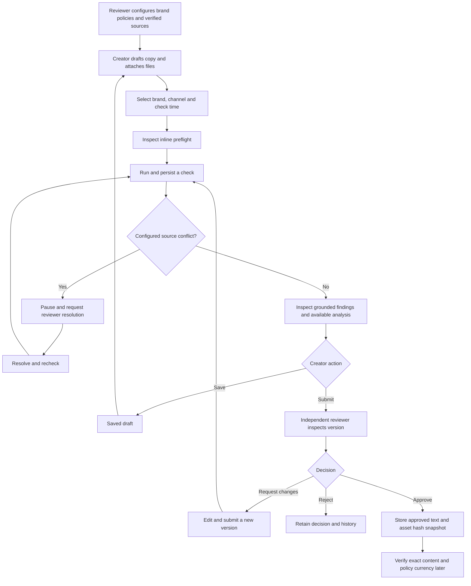
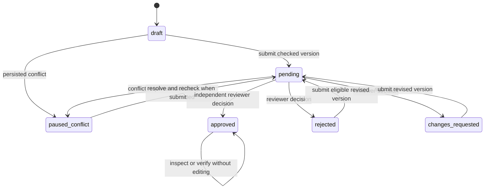
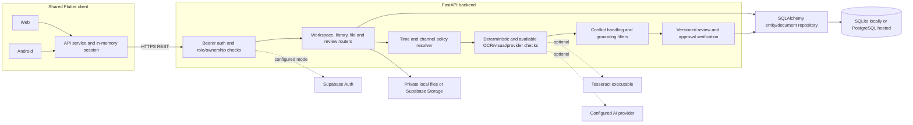
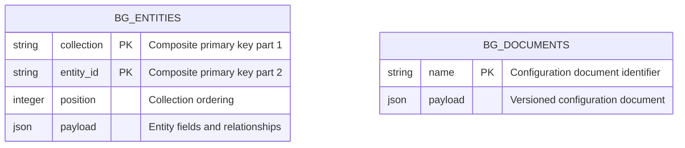
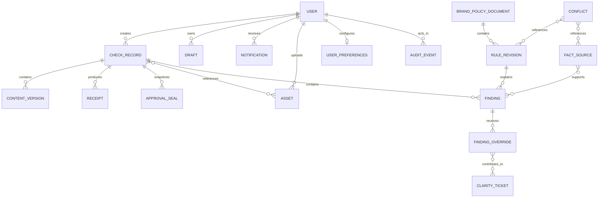
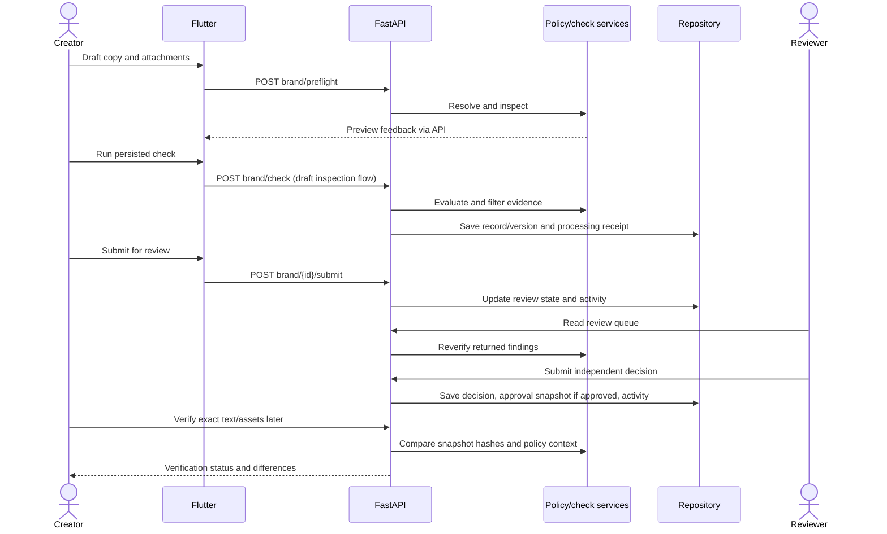

<div align="center">

# BrandGuard

### Evidence-first governance for marketing copy and campaign creatives

**No finding without evidence. No approval without a version.**

[](https://brandguard-vercel-code-nova.vercel.app)
[](https://github.com/smeet-jari18/brandguard-vercel-CodeNova)


[Open the application](https://brandguard-vercel-code-nova.vercel.app) · [Source code](https://github.com/smeet-jari18/brandguard-vercel-CodeNova) · [Local setup](#quick-start-local-application) · [Architecture](#architecture) · [Testing](#testing)

</div>

---

## What is BrandGuard?

BrandGuard brings content checks, policy evidence and human review into one workflow. Creators draft marketing copy or attach campaign files, inspect findings against applicable brand policies, and submit a specific version for review. Independent Reviewers approve, reject or request changes. Approval verification later checks the exact text and assets against the approved snapshot and identifies relevant policy changes.

It is a **brand-governance application**, not a counterfeit-product detector, unrestricted fact checker or automatic legal-certification service. A clean scan is not a human approval. An AI response never grants publication authority.

### Who is it for?

| User | Primary responsibilities |
|---|---|
| Creator | Draft, attach files, check content, inspect evidence, save drafts, submit and revise |
| Reviewer | Inspect submissions, make decisions, manage policy/source libraries, resolve governance issues |
| Admin | Trusted reviewer-level access and account/operational administration through supported tools |

Roles and record ownership are checked by the backend. Reviewer/Admin users may also author checks; the same identity cannot approve its own submission.

## Contents

- [Capabilities](#capabilities)
- [Product workflow](#product-workflow)
- [Architecture](#architecture)
- [Database design](#database-design)
- [Repository structure](#repository-structure)
- [Quick start: local application](#quick-start-local-application)
- [Run or build the Flutter client](#run-or-build-the-flutter-client)
- [Configuration](#configuration)
- [Supabase setup](#supabase-setup)
- [Optional OCR and AI](#optional-ocr-and-ai)
- [API overview](#api-overview)
- [Testing](#testing)
- [Deployment](#deployment)
- [Data administration](#data-administration)
- [Security model and limitations](#security-model-and-limitations)
- [Troubleshooting](#troubleshooting)
- [Roadmap](#roadmap)
- [Contributing](#contributing)
- [Team and license](#team-and-license)

## Capabilities

### Content creation and checking

- Brand-scoped checks for text and supported attachments.
- Fresh checks start with **New brand** and an empty brand input; saved drafts retain their brand.
- Acme, Zest Foods and Skyline Travel shortcuts select policy scopes; they are not approvals.
- Custom brand names are supported. Reviewers must configure their policies separately; selecting a new name does not create rules.
- Channel and point-in-time `check_at` context.
- Inline preflight feedback before a persisted check/review submission.
- Evidence inspection, suggested replacements where provided, saved drafts and revision-aware updates.
- Explicit submission after inspection, versioned resubmission, and linked new checks from approved material.

### Evidence and policy governance

- Reviewer-managed rules, prose guidelines and verified Fact Sources.
- Versioned policies with effective/expiry windows, supersession and channel scoping.
- Regex findings with policy references, verbatim quotations and exact content spans.
- Grounding filters on generated findings and re-verification in the review queue.
- Metadata-driven conflict detection, abstention/pause, reviewer resolution and optional recheck.
- Structured finding overrides with six reason codes; repeated friction can create clarity tickets.
- Optional source-grounded provider verification with explicit abstention when unavailable or unsupported.

> **Grounding boundary:** the full re-verification gate is not uniformly applied to receipt/history reads. Quote-offset fields are optional and validated when supplied together. Visual findings use structured visual evidence rather than invented text spans. See [limitations](#security-model-and-limitations) before treating the gate as a universal guarantee.

### Files and creative inspection

- PNG, JPG/JPEG, WEBP, UTF-8 TXT/Markdown and text-based PDF uploads, up to **5 MiB**.
- Access-controlled previews/downloads and file SHA-256 hashes.
- Tesseract OCR integration, OCR-origin evidence and explicit unavailable/error states.
- Dominant-palette analysis and perceptual logo-template checks when applicable visual rules exist.
- Reviewer logo-template upload and optional Vision AI integration.
- Text-based PDF extraction; arbitrary scanned-PDF OCR is not implemented.

### Human review and approval assurance

- Review queue, author/timeline metadata, approve/reject/request-changes decisions.
- Ownership checks, independent review and stale-version guards.
- Decision amendments by eligible reviewers within a configurable window; default **60 minutes**.
- Revocation of superseded approval snapshots and retained decision history.
- Exact text/asset verification, word-level differences and named rule changes.
- Processing receipts, history, application audit records and approval inspection.

### Application experience and operations

- Dashboard/analytics, drafts, notifications and seen/unseen controls.
- Notification destinations open without waiting for read acknowledgement; loading feedback and repeat-opening guards.
- Profile/password/preferences, remembered sign-in email, and light/dark/system appearance.
- In-app assistant with scoped context and deterministic fallback; it cannot approve content or silently change policy.
- Transactional SQLite/PostgreSQL persistence, private backup/inventory tooling and explicit-ID cleanup planning.
- Shared Flutter web/Android source, Vercel deployment wiring and an alternative non-root Docker image.

## Product workflow



### Check/review states versus verification results

These are different concepts. A verification failure is not necessarily a mutation of the stored review decision.



The diagram summarises the workflow rather than enumerating every guarded API transition. Amendments have actor, time-window and version checks. Approved material is revised through a **linked new check**, not silently edited in place.

| Verification result | Meaning |
|---|---|
| `SEALED` | Exact submitted content/assets and applicable policy context match |
| `VOIDED_TAMPERED` | Submitted text/assets differ from the stored approved snapshot |
| `INVALIDATED_RULE_CHANGE` | Relevant policy context has changed |
| `REVOKED` | A prior approval was revoked/superseded through amendment |
| `NOT_APPROVED` | No applicable approval, wrong brand, or ineligible current status |

## Architecture



### Implementation layers

| Layer | Technology and responsibility |
|---|---|
| Client | Flutter/Dart, `material_ui`/Cupertino, HTTP, `file_selector`, local preferences |
| API | FastAPI, Pydantic request/response validation, authenticated routers |
| Evaluation | Temporal policy resolution, regex, verified-source helpers, OCR/visual inspection, optional providers, grounding |
| Workflow | Content versions, decisions, overrides, conflict resolution, receipts, notification/audit records |
| Persistence | SQLAlchemy, JSON entity payloads and configuration documents |
| Authentication | Local password/JWT mode or configured Supabase Auth |
| Deployment | Vercel ASGI entrypoint and static web assets; alternative Docker/same-origin Uvicorn |

`brand.py:inspect_content` performs caption/image work with bounded thread pools. Source conflicts cause abstention rather than an arbitrary winner. The pipeline is orchestrated in code; the architecture diagram is conceptual, not a claim that all checks run in one serial order.

## Database design

### Physical schema: two application tables

> **Diagram viewing:** GitHub renders the Mermaid diagrams below. If your Markdown viewer does not, open the [static database-schema SVG](docs/assets/brandguard-database-schema.svg). Badges use external Shields.io images and require network access.

BrandGuard does **not** create separate SQL tables for every domain concept. The implemented application repository uses these two tables:



There is no SQL foreign key between these tables. Relationships and lifecycle rules are enforced in the application. Supabase Auth and object-storage tables are external to this two-table application schema.

### Logical domain relationships

The following ER diagram explains **JSON-payload relationships**, not additional physical SQL tables or declared database foreign keys. Some references are optional; drafts are distinct from persisted check records.



- `bg_entities` includes collections such as review records, receipts, users/auth records, facts, guidelines, drafts, assets, overrides, clarity tickets, conflicts, notifications and seals.
- `bg_documents` stores configuration objects such as the versioned brand-rules document.
- Content versions/findings may be nested inside record payloads; not every logical diagram node is an independent entity row.
- Rule findings reference rules; AI fact findings can instead be grounded in verified facts. The diagram summarises both paths.
- Read `backend/app/database.py` for actual schema/key mappings and `backend/migrations/001_core.sql` for the core SQL definition.

### Transactions and integrity

Nested mutations share one transaction. SQLite uses `BEGIN IMMEDIATE` and WAL settings; PostgreSQL uses advisory transaction locking. This prioritises consistency but is **not** evidence of high-throughput scalability.

Approvals store SHA-256 hashes of exact text and a composite of brand/text/asset hashes. They are **hash-based snapshots**, not public-key signatures, immutable storage, or an externally anchored hash chain. A privileged database writer remains outside that integrity boundary.

## Repository structure

```text
.
├── backend/
│   ├── app/
│   │   ├── approval/          # Hash snapshots, decisions and verification
│   │   ├── audit/             # Application audit records
│   │   ├── checks/            # Grounding, conflicts, regex, AI and visual analysis
│   │   ├── overrides/         # Overrides and clarity tickets
│   │   ├── receipts/          # Processing receipts
│   │   ├── routers/           # Auth, library, workspace, files, review and APIs
│   │   ├── rules_store/       # Versioned temporal policies
│   │   ├── schemas/           # Pydantic request/response models
│   │   ├── database.py        # SQL entity/document repository
│   │   ├── main.py            # FastAPI application
│   │   └── web.py             # Optional same-origin static web host
│   ├── certs/                 # Bundled public CA certificate, not a private key
│   ├── demo/                  # Fictional policy catalogue and selection template
│   ├── migrations/            # Core application SQL
│   ├── supabase/              # Private-storage and related deployment SQL
│   ├── tests/                 # Legacy-adapter regression coverage
│   ├── tests_secure/          # SQL/bearer-auth and product/security coverage
│   ├── .env.example
│   ├── demo_admin.py          # Explicit maintenance and API-based demo seeding
│   └── manage.py              # Trusted server administration
├── mobile/                    # Flutter source, assets, platforms and tests
├── browser_preview/           # Compiled web assets used for deployment
├── public/                    # Published static assets; Vercel build refreshes these
├── demo_samples/              # Sample campaign inputs
├── docs/                      # Detailed setup guides
├── validation/                # Historical validation evidence, not all current
├── main.py                    # Vercel ASGI entrypoint
├── vercel.json                # Vercel build/static routing/security configuration
├── Dockerfile                 # Alternative non-root Python/Tesseract runtime
├── serve.py                   # Production same-origin server entrypoint
└── start_backend.py           # Local environment/bootstrap launcher
```

## Quick start: local application

### Prerequisites

- Git.
- **Python 3.13 recommended**; `.python-version` selects 3.13. The launcher accepts 3.11+, but the full pinned environment was validated on 3.13.
- Internet for dependency installation.
- Flutter is **not required** to serve the bundled web build. Rebuilding the UI requires a compatible Flutter/Dart installation; the inspected project declares **Dart `^3.14.0`**, with Flutter **3.50.0** used during development.
- Optional Tesseract executable for real OCR.

### 1. Clone

```bash
git clone https://github.com/smeet-jari18/brandguard-vercel-CodeNova.git
cd brandguard-vercel-CodeNova
```

### 2. Select isolated local configuration

For a fresh clone, copy `backend/.env.example` to `backend/.env` and keep:

```dotenv
AUTH_PROVIDER=local
SEED_DEMO_USERS=true
AI_PROVIDER=disabled
```

Leave cloud/database credentials unset for local SQLite development. **Do not overwrite an existing configured `.env`.** Check inherited shell environment variables too: they can take precedence over `.env`.

**Windows PowerShell — copy only when absent:**

```powershell
if (-not (Test-Path backend\.env)) { Copy-Item backend\.env.example backend\.env }
```

**macOS/Linux — copy only when absent:**

```bash
test -f backend/.env || cp backend/.env.example backend/.env
```

### 3. Start the bundled application

Windows:

```powershell
py -3.13 start_backend.py --web
```

macOS/Linux:

```bash
python3.13 start_backend.py --web
```

The launcher creates `backend/.venv`, installs runtime requirements and starts the server. Keep its terminal open; stop with `Ctrl+C`.

- Application: **http://127.0.0.1:8000/**
- Health: **http://127.0.0.1:8000/health**
- Interactive API docs: **http://127.0.0.1:8000/docs**

If port 8000 is occupied:

```bash
python3.13 start_backend.py --web --port 8001
```

Use `py -3.13` instead of `python3.13` on Windows.

### Local demonstration accounts

Available when using local auth with demo seeding enabled:

| Role | Email | Password |
|---|---|---|
| Creator | `creator@brandguard.demo` | `Demo@12345` |
| Reviewer | `reviewer@brandguard.demo` | `Demo@12345` |

**These are development-only accounts.** They are not a promise of hosted access. Never enable default demo users against a public production environment.

### Manual backend start

Use this instead of the launcher when you want explicit environment control.

Windows, from the repository root:

```powershell
cd backend
py -3.13 -m venv .venv
.\.venv\Scripts\python.exe -m pip install -r requirements-dev.txt
.\.venv\Scripts\python.exe -m uvicorn app.web:app --host 0.0.0.0 --port 8000
```

macOS/Linux:

```bash
cd backend
python3.13 -m venv .venv
.venv/bin/python -m pip install -r requirements-dev.txt
.venv/bin/python -m uvicorn app.web:app --host 0.0.0.0 --port 8000
```

Use `app.main:app` for API-only hosting. `app.web:app` needs a valid bundled web build and serves it alongside the API. **Do not run the root Vercel `main.py` as the local SQLite entrypoint**; it deliberately requires hosted Supabase configuration.

## Run or build the Flutter client

### API selection

| Client | Default | Local override |
|---|---|---|
| Browser | Same origin as the web application | Explicit `API_BASE` |
| Native Android | Hosted Vercel API | Explicit `API_BASE` |
| Standard Android emulator | Native default unless overridden | Host computer usually at `10.0.2.2` |
| Physical phone | Hosted Vercel API | Reachable computer LAN address if developing locally |

Never embed database credentials, secret/service-role keys or provider keys in Dart/build arguments. `API_BASE` is a public server address only.

From `mobile/`:

```bash
flutter pub get
flutter analyze
flutter test
```

Run Chrome against the hosted API:

```bash
flutter run -d chrome --dart-define=API_BASE=https://brandguard-vercel-code-nova.vercel.app
```

Or against a running local backend:

```bash
flutter run -d chrome --dart-define=API_BASE=http://127.0.0.1:8000
```

For a standard Android emulator:

```bash
flutter run --dart-define=API_BASE=http://10.0.2.2:8000
```

Local HTTP may need development-only cleartext/network configuration and appropriate CORS/firewall access. Do not distribute release builds targeting a developer machine.

### Android APK

Install Android Studio, Android SDK Platform/Build/Command-line Tools and verify:

```bash
flutter doctor
flutter doctor --android-licenses
flutter build apk --release --dart-define=API_BASE=https://brandguard-vercel-code-nova.vercel.app
```

Output:

```text
mobile/build/app/outputs/flutter-apk/app-release.apk
```

**Release boundary:** the current Android build configuration uses debug signing and disables release lint checks. An installable APK is not a production-signed Play Store release. Before public/store distribution, configure a private signing key, resolve toolchain/lint issues and restore appropriate release checks. Keep signing secrets out of Git.

### Rebuild web assets

From `mobile/`:

```bash
flutter build web --release --no-web-resources-cdn
```

Then refresh the deployment bundle.

PowerShell, still in `mobile/`:

```powershell
Copy-Item -Path .\build\web\* -Destination ..\browser_preview\ -Recurse -Force
```

macOS/Linux:

```bash
cp -R build/web/. ../browser_preview/
```

Review stale files when replacing an older build; copying does not automatically remove obsolete assets. Keep changes to generated output separate from secret/runtime data. Building or running locally does **not** update the hosted application—deploy the reviewed output.

## Configuration

`backend/.env.example` is the configuration reference. `backend/.env` is private and must not be committed. Configure the process environment on hosted platforms; do not upload a completed `.env`.

| Setting | Purpose |
|---|---|
| `AUTH_PROVIDER` | `local` or `supabase` |
| `SEED_DEMO_USERS` | Local demonstration accounts; `false` in production |
| `DATABASE_URL` | PostgreSQL URL, or unset for local SQLite |
| `BRANDGUARD_DATA_DIR` | Runtime data directory; local default is under `backend/data` |
| `JWT_SECRET` | Strong server-only local-auth signing secret; preserve/rotate deliberately |
| `SUPABASE_URL` | Intended Supabase project HTTPS URL |
| `SUPABASE_PUBLISHABLE_KEY` | Project publishable/legacy anon key used by supported integration |
| `SUPABASE_STORAGE_BUCKET` | Private file bucket; default `brandguard-files` |
| `SUPABASE_SECRET_KEY` / `SUPABASE_SERVICE_ROLE_KEY` | Optional trusted server administration key; never a client credential |
| `PUBLIC_APP_URL` | Public application origin, also used by applicable security/recovery logic |
| `AUTH_REDIRECT_URL` | Configured auth recovery/redirect endpoint |
| `CORS_ORIGINS` | Comma-separated allowed browser origins; localhost regex is also configured |
| `AI_PROVIDER` | `disabled`, `gemini`, `openrouter` or `openai` |
| `AI_API_KEY`, provider-specific key variables | Server-only provider access |
| `AI_BASE_URL`, `AI_MODEL` | Provider endpoint/model overrides |
| `TESSERACT_CMD` | Optional full executable path if Tesseract is not discovered |
| `DECISION_AMEND_WINDOW_MINUTES` | Reviewer amendment grace window; default 60 |
| `OVERRIDE_FRICTION_THRESHOLD` | Repeated override threshold; default 3 |
| `SUPABASE_EMAIL_HOOK_SECRET`, `RESEND_API_KEY`, `RESEND_API_URL`, `EMAIL_FROM` | Configured auth email integration; see setup guides |

A variable being set is not proof the remote service is reachable, funded or correctly authorised. Provider configuration can be auto-selected from supported provider-specific keys when `AI_PROVIDER` is unset; use `AI_PROVIDER=disabled` to explicitly disable it.

### Connection safety

- Use the intended project's connection details; local SQLite and hosted PostgreSQL are different datasets.
- URL-encode special characters in database passwords.
- Use verified TLS for hosted database connections. The example provides `sslmode=verify-full`, the bundled public CA path and a connection timeout.
- Relative certificate paths resolve from the process working directory. Run backend administration from `backend/` or use an absolute certificate path.
- Never paste connection strings, `.env`, recovery URLs or private keys into issues/chat. Rotate exposed credentials and coordinate all dependent service updates.

## Supabase setup

Use [the detailed Supabase guide](docs/SUPABASE_SETUP.md) for project, connection, auth, role and private-storage configuration.

1. Choose the intended project and take a backup if it already contains data.
2. Review core SQL in `backend/migrations/001_core.sql` and private storage configuration in `backend/supabase/002_private_storage.sql`. Apply only what the target environment requires; do not blindly rerun migrations against a populated deployment.
3. Configure hosted auth/PostgreSQL settings privately:

   ```dotenv
   AUTH_PROVIDER=supabase
   SEED_DEMO_USERS=false
   ```

4. Set the actual project URL, publishable key, verified-TLS `DATABASE_URL`, private bucket and redirect settings.
5. Provision Reviewer/Admin roles through supported trusted administration—not client-editable profile fields.
6. Validate the registered redirect URLs and actual mail delivery if using signup/recovery confirmation flows.
7. Confirm both application tables and test separate Creator/Reviewer access.

Supabase Auth identities and object files are not the same thing as application-table rows. An application JSON backup alone is not a complete Supabase project backup. Do not change a working auth mode solely because the database happens to be hosted on Supabase.

## Optional OCR and AI

### Tesseract OCR

Install the **Tesseract executable** as well as Python requirements. The Docker image includes the executable. Local development can find it on `PATH` or via `TESSERACT_CMD`.

```bash
tesseract --version
```

If unavailable, inspect `ocr_status`; image upload success alone does not prove text was extracted. Scanned PDF pages are not automatically rasterised into OCR inputs. OCR and perceptual matching can be wrong; evaluate representative creatives before relying on their accuracy.

### Source-grounded AI

Supported provider integrations include Gemini and OpenAI-compatible OpenRouter/OpenAI endpoints. Configure provider keys **only on the backend**. Add relevant Fact Sources, verify them as a Reviewer, then run the supported live probe.

From `backend/`, using its environment's Python:

```bash
python manage.py configure-ai
python manage.py test-ai
```

On Windows you can invoke `.\.venv\Scripts\python.exe` directly; on macOS/Linux use `.venv/bin/python`. `configure-ai` changes local configuration; review settings before using it against production. See [AI setup](docs/AI_SETUP.md).

Authenticated Reviewers can also use `POST /api/v1/system/ai-test`. `/system/status` describes configuration and deliberately does not equate that with live provider success.

- Provider factual comparison is bounded to supported content/source limits, including a 12,000-character input limit for that path.
- Missing provider access, irrelevant/unverified evidence or validation failure can produce **abstention**.
- The assistant offers explanations/fallback checks; it is not a reviewer or an unrestricted truth oracle.

## API overview

Run the backend and open **`/docs`** for the authoritative generated schemas. Most application routes require a valid bearer token; authenticated access remains role/ownership scoped.

```http
Authorization: Bearer <access-token>
```

| Area | Representative routes |
|---|---|
| Authentication | `POST /api/v1/auth/login`, `/signup`, `/refresh`, `/logout`, `/recover` |
| Account | `GET /api/v1/auth/me`, `PATCH /api/v1/auth/profile`, `PUT /api/v1/auth/password`, `GET/PUT /api/v1/auth/preferences` |
| Checks | `POST /api/v1/brand/preflight`, `/check`, `/{check_id}/versions`, `/{check_id}/submit` |
| Files | `POST /api/v1/files`, `GET /api/v1/files/{asset_id}`, `/{asset_id}/download` |
| Library | `GET/POST /api/v1/library/{kind}`, `PUT/DELETE /api/v1/library/{kind}/{item_id}`; kinds include rules/guidelines/facts |
| Logo templates | `POST /api/v1/library/rules/{rule_id}/logo-template` |
| Reviews | `GET /api/v1/reviews`, `PATCH /api/v1/reviews/{check_id}/decision`, `POST /api/v1/reviews/{check_id}/amend` |
| Verification | `POST /api/v1/approvals/verify`, `/verify-upload` |
| Governance | `/api/v1/conflicts`, `/api/v1/overrides`, `/api/v1/clarity-tickets` and guarded mutation routes |
| Finding override | `POST /api/v1/reviews/{check_id}/findings/{finding_id}/override` |
| Workspace | `/api/v1/drafts`, `/api/v1/history`, `/api/v1/analytics`, `/api/v1/notifications` |
| Evidence/activity | `/api/v1/receipts/`, `/api/v1/audit` |
| Assistant/diagnostics | `POST /api/v1/assistant/chat`, `GET /api/v1/system/status`, `POST /api/v1/system/ai-test` |
| Health | `GET /health` |

### Submission sequence



The diagram represents the UI's two-step inspection/submission flow; API schemas also expose submission options. State, actor and version guards still apply.

## Testing

### Backend

Use an isolated local/test configuration, **not production secrets**.

Windows, from `backend/`:

```powershell
.\.venv\Scripts\python.exe -m pip install -r requirements-dev.txt
.\.venv\Scripts\python.exe -m pytest -q
```

macOS/Linux:

```bash
.venv/bin/python -m pip install -r requirements-dev.txt
.venv/bin/python -m pytest -q
```

Targeted multimodal coverage:

```bash
python -m pytest tests_secure/test_phase3_multimodal.py -q
```

Use the backend virtual environment's Python. Install Tesseract to exercise the real OCR cases.

### Flutter

From `mobile/`:

```bash
flutter pub get
flutter analyze
flutter test
```

### Recorded validation and evidence boundaries

| Evidence | Result / qualification |
|---|---|
| Backend audit run on `980ec2c049c1c56e7a133d84c54cb4102e4e7c24` | **176 passed, 2 skipped**, 1 deprecation warning, 57.58 s; Python 3.13 |
| Skips | Two real OCR integration cases; Tesseract executable absent |
| Latest source review at `8bf0deffb686d5ac5e496c1d92d906ff1f3e9999` | Backend app/tests and Flutter lib matched that audit snapshot byte-for-byte; this is not a claimed fresh test execution |
| Flutter evidence | 15 top-level test files; no final commit-matched all-pass count is asserted here |
| Existing `validation/` | Historical logs for earlier versions/hosts; inspect their context before using them as current evidence |

Backend coverage includes grounding, temporal windows/facts, conflicts, overrides, tampering/revocation, authentication/ownership, file validation, unavailable-service fallbacks, provider contracts and maintenance safeguards. Some legacy regression tests use the JSON adapter and test-only ID headers; secure tests exercise SQL/bearer authentication. Passing unit/API tests is not a production penetration test or proof of hosted service availability.

### Manual smoke checklist

- [ ] Separate Creator and Reviewer can sign in; ownership and self-review restrictions hold.
- [ ] Empty/invalid input gives an actionable response.
- [ ] New brand starts blank; a saved draft restores its actual brand/content.
- [ ] Installed policies produce expected findings under the correct brand/channel/time.
- [ ] Submit → review → request changes → resubmit works without overwriting prior versions.
- [ ] Approved exact text/assets verify; edited text/assets fail exact verification.
- [ ] Applicable policy changes are identified during verification.
- [ ] Notifications open with loading feedback; repeated actions do not appear to hang.
- [ ] OCR/provider-unavailable states are explicit; configured services are probed separately.
- [ ] Check refresh, expired session, offline/network failure and narrow/high-text-scale layouts.

## Deployment

### Vercel

This repository includes the deployment entrypoint and static build configuration:

- Root `main.py` exports FastAPI, sets the backend working directory and temporary runtime data directory, and requires Supabase auth, PostgreSQL and disabled demo-user seeding.
- `vercel.json` selects FastAPI, copies `browser_preview/` into `public/`, serves the root HTML and configures headers/function exclusions.
- Root `requirements.txt` includes backend runtime requirements.

Deployment steps:

1. Build/copy the current Flutter web bundle as described above.
2. Connect the intended repository/branch to the existing Vercel project.
3. Configure actual production auth/database/storage/public URL values privately in Vercel.
4. Keep `AUTH_PROVIDER=supabase` and `SEED_DEMO_USERS=false`.
5. Review TLS, redirects, storage policies, secrets and required dependencies.
6. Deploy the reviewed commit; verify root, `/health`, login and independent review workflows.
7. Verify optional OCR/provider health on Vercel separately—Docker's installed Tesseract does not imply it exists in Vercel's runtime.

**Do not run cleanup, seed, restore or account provisioning in a build/start hook.** Environment-variable changes require the appropriate redeployment. A health response confirms reachability, not commit identity or complete product correctness.

### Docker / same-origin server

The Docker image uses Python 3.13, installs Tesseract and runs as a non-root user. It starts `serve.py`, which enforces production Supabase auth and demo-seeding restrictions.

Example after privately preparing valid production configuration:

```bash
docker build -t brandguard .
docker run --rm --env-file backend/.env -e PORT=8080 -p 8080:8080 brandguard
```

The sample local `.env` is **not** sufficient: production entrypoints reject local auth/demo mode. Use a valid container-side TLS certificate path and reachable hosted services. Runtime temporary files are not a durable object-store strategy; use configured private storage.

## Data administration

These tools have real database/API effects. Run only in a trusted environment after verifying the target. They are not required for a normal end user to run the app.

### Safe application backup

From `backend/`, using its environment's Python:

```bash
python manage.py backup --output .demo-private/pre-change.json
```

The destination is exclusive-create; use a fresh filename for each backup. Backups may contain password hashes/session data. Keep them private and preserve local JWT secrets where applicable. Back up Auth identities and private files separately as appropriate.

### Inventory without deletion

```bash
python demo_admin.py inventory --out .demo-private/inventory.json
```

Review actual IDs and policies privately. For cleanup, use the documented **selection → plan → owner approval → transaction backup → apply** workflow. Never delete all rows to make the interface look clean. Restore overwrites application data; do not run it as an exploratory step.

See [maintenance and release guide](DEMO_SETUP_AND_RELEASE.md) and [run commands](FINAL_RUN_COMMANDS.md). Check current code/target before copying an administrative command from any guide.

### Brand catalogue and demo seeding

`backend/demo/catalog.json` contains **fictional demo policies**: four rules and one guideline each for Acme, Zest Foods and Skyline Travel. It is an input to supported setup—not a Supabase table export.

- A Reviewer can add missing policies through the app, checking for duplicates first.
- `demo_admin.py seed` also creates real demonstration workflow records through APIs and expects a dedicated empty Creator workspace. It is **not a policy-only import**.
- Review `--archive-extra-rules` before using it; it changes current policy membership.
- Preserve seed state and reconcile uncertain `inflight` mutations before retrying.
- Existing checks need not be deleted just to add policies/guidelines.

## Security model and limitations

### Implemented safeguards

- Backend-issued identity and owner/reviewer access control.
- Bearer authentication; production configuration does not expose a public ID-header login bypass.
- In-memory client tokens; logout and refresh-race protections.
- Validated request schemas, upload restrictions and private file access.
- Policy/evidence checks, version guards, independent decisions and audit records.
- CSP/security headers, API `no-store`, configured CORS and conditional HSTS.
- Explicit backup/cleanup plans with stale-snapshot and reference guards.

### Boundaries to understand

1. **Grounding:** full receipt/history read parity and mandatory quote-offset presence remain gaps. Gate checks for visual evidence do not independently recompute the measurement.
2. **Approval integrity:** SHA-256 snapshots detect defined content/asset changes; they are not signed immutable ledgers and do not protect against all privileged infrastructure compromise.
3. **Audit:** application records are not externally immutable. Do not describe them as tamper-proof storage.
4. **Sessions:** remembered email is not persistent login; tokens remain in memory.
5. **OCR/AI:** optional, fallible and configuration-dependent. No accuracy/recall benchmark, factual guarantee or complete legal compliance is claimed.
6. **Conflict detection:** driven by configured topic/value metadata, not unrestricted semantic contradiction detection.
7. **Mobile release:** debug signing and disabled release lint require hardening before production distribution.
8. **Scale:** collection payloads and advisory locking require measured scaling work before high-volume multi-tenant use.
9. **External services:** email, provider quota, auth redirects and storage access need real environment tests.
10. **Version labels:** API health reports 2.0.0 while `pubspec.yaml` is 2.1.0+4. Use the Git commit/build identifier to identify an exact source release.

Report suspected vulnerabilities privately to the maintainers through an available private channel. Do not include secrets or private user content in public issues.

## Troubleshooting

| Symptom | What to check |
|---|---|
| `No Android SDK found` | Install Android Studio SDK tools; configure the actual SDK path; rerun `flutter doctor` |
| Visual Studio warning on Windows | Not required for Android APK/web builds; it concerns Windows desktop builds |
| Gradle download `Premature EOF` or prolonged silent startup | Stable network, leftover Gradle wrapper processes and distribution download/lock state; do not run parallel builds or blindly change Gradle versions |
| Copied `.venv` points to another user's Python | Virtual environments are machine-specific; preserve configuration and recreate `.venv` with installed Python, then reinstall requirements |
| Hosted login fails against local server | Local-auth accounts and Supabase accounts are different; verify `API_BASE` and actual auth mode before resetting passwords |
| Certificate file not found | Verify CA file and backend working directory/absolute path; do not disable TLS verification |
| SQL configuration unexpectedly uses SQLite | `.env` missing/not loaded or DATABASE_URL unset; stop administration until the intended target is verified |
| Browser CORS error | Add the actual development frontend origin to backend CORS settings; native apps do not use browser CORS |
| AI says `abstained` | Provider/config/quota, 12k limit, relevant verified facts and schema/citation validation; use live diagnostics |
| Image uploaded but no OCR findings | Inspect `ocr_status`, Tesseract availability, readable text and applicable policies |
| Unknown brand has few findings | Brand-specific policies may not exist; global checks are not full brand coverage |
| Approval no longer verifies | Inspect exact text/asset hashes, revocation state, version and named rule changes |
| Refresh/restart returns to sign-in | Tokens are in memory; remember-email is not durable login |
| Local changes absent on hosted website | Rebuild web assets, copy to browser_preview and deploy the intended commit; inspect caching |
| Only old validation numbers are visible | Historical logs do not automatically describe current code; rerun tests and label evidence by commit |

## Roadmap

Planned work is not a claim of delivered functionality or a fixed delivery date.

- **Release hardening:** universal grounding read coverage, stricter offset semantics, clearer drop auditing, production signing/lint and commit-matched device/provider evidence.
- **Better governance:** reviewer-managed brand directory, policy import/preview/diffs, richer provenance and policy regression packs.
- **Reliability/accessibility:** request tracing, service health, targeted recovery, keyboard/screen-reader/high-text-scale validation and restore rehearsals.
- **Scale and collaboration:** tenant isolation, organisational provisioning, queued OCR/creative processing, finer-grained queries/locking and measured load tests.
- **Longer term:** integrations, multilingual evaluation and optional external signing/anchoring if the threat model requires it.

Measure journey success/error rates, verification correctness, OCR/visual precision/recall, latency distributions, provider abstention and restore outcomes before making quantified claims.

## Contributing

1. Branch from the intended current source revision.
2. Keep backend changes covered with isolated tests and client changes with appropriate widget/navigation tests.
3. Run backend tests, `flutter analyze` and `flutter test` for affected layers.
4. Document schema/config changes and migration/rollback implications.
5. Rebuild the web bundle when shipping UI changes; never commit `.env`, runtime databases, backups, uploaded private content or signing/provider secrets.
6. In a pull request, distinguish implemented code, executed tests, configuration-dependent integrations and unresolved limitations.

Additional guides: [AI setup](docs/AI_SETUP.md), [Supabase setup](docs/SUPABASE_SETUP.md), [deployment](DEPLOYMENT.md), [project guide](docs/PROJECT_GUIDE.md). Some supporting guides and historical validation files may refer to earlier hosts; this README uses Vercel as the current public entry point.

## Team and license

**Code Sprinters**

- **Prafull Mayank Singh** — Team leader; Frontend Designer
- **Omkar Solat** — Database Designer
- **Smeet Jariwala** — Backend Developer
- **Swapnil Dhodi** — UI/UX
- **Shivansh Gupta** — Backend Developer
- **Prince Rana** — Frontend Designer

### License

The repository's `LICENSE` currently contains a placeholder, not a completed open-source license grant. Do not assume MIT/Apache or unrestricted reuse. The maintainers should select and publish the intended license before broader distribution.
